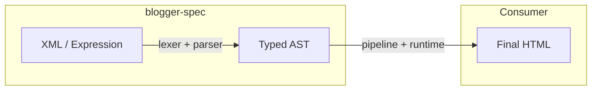

# blogger-spec

> Specification, data catalogs, and runtime tooling for the Blogger XML template language.

[](LICENSE)
[](package.json)

Standalone package that formalizes the syntax, type system, directive grammar, operator precedence, compiler token quotas, and runtime data paths of Blogger XML templates. IDE extensions, linters, compilers, and validators can share one versioned understanding of the language.

Zero runtime dependencies and no Node built-ins: it works in browsers, Node.js, Cloudflare Workers, and Web Workers.

## Scope



- **Provided here:** template parser (`parseTemplate`), expression parser (`parseExpression`), expression evaluator (`evaluateExpression`), 12 mock view contexts, 11 JSON catalogs with schemas, and a conformance runner (`runConformance`).
- **Left to the consumer:** template rendering (AST traversal, section/widget wrappers, loops and subroutines), preview servers, watchers, and site generation.

## Modules

| Subpath | Purpose |
| :--- | :--- |
| `blogger-spec/ast` | `parseTemplate` and `parseExpression` (Pratt parser, 10 precedence levels, `maxDepth: 50`). Supports infix and functional syntax, lambdas, and bracket indexing. |
| `blogger-spec/parser` | Tokenizer, `evaluateExpression`, directive scanning, and validators: `validateDirectiveNesting`, `validateTemplateStructure`, `validateTemplateExpressions`. |
| `blogger-spec/quota` | Token counting against the compiler's 40-token limit (`BX1021`). |
| `blogger-spec/type-system` | Assignability, modifiers, skin modifiers, operator compatibility, and type inference. |
| `blogger-spec/data-path` | `resolveDataPath` across globals, widgets, platform types, messages, scoped variables, and skin variables. |
| `blogger-spec/scope` | `ScopeEnvironment`: scope stack with shadowing and the precedence `lambda → loop → with → includable → widget → global`. |
| `blogger-spec/version` | Layout version detection (v1, v2, v3). |
| `blogger-spec/catalogs` | Query facade, `getMockContext`, and snippet generators. |
| `blogger-spec/inclusion-expander` | Server-side inclusion expansion and macro inlining. |
| `blogger-spec/runner` | `runConformance`, `runSpecConformance`, `normalizeHtmlString`. |
| `blogger-spec/node` | Optional Node-only `FsCatalogStore`. |

### Catalogs

`directives`, `operators`, `types`, `widgets`, `settings`, `globals`, `messages`, `scopes`, `diagnostics` (BX1001–BX1062), `inclusions`, `locales`. Each has a Draft 2020-12 schema under `catalogs/schemas/`.

```typescript
import operators from 'blogger-spec/operators' with { type: 'json' }
```

## Installation

```bash
npm install blogger-spec
# or
pnpm add blogger-spec
```

Everything is exported from the root, or import from the subpaths above:

```typescript
import { parseExpression, parseTemplate, resolveDataPath } from 'blogger-spec'
import { evaluateExpressionBudget } from 'blogger-spec/quota'
```

## Usage

### Parse and evaluate expressions

```typescript
import { evaluateExpression, parseExpression } from 'blogger-spec'

const ast = parseExpression('data:posts filter (p => p.labels any (l => l.name == "News"))')
const result = evaluateExpression(ast, {
  posts: [
    { title: 'Post 1', labels: [{ name: 'Tech' }] },
    { title: 'Post 2', labels: [{ name: 'News' }] },
  ],
})
// [ { title: 'Post 2', ... } ]
```

### Parse a template

```typescript
import { parseTemplate } from 'blogger-spec'

const doc = parseTemplate(xml, { tolerant: false })
// doc.type === 'Document'
```

### Check the token budget (`BX1021`)

```typescript
import { evaluateExpressionBudget } from 'blogger-spec/quota'

evaluateExpressionBudget('data:posts[0].labels[0].name ?: "Default"')
// { totalTokens: 5, isValid: true, status: 'SAFE' }
// status: 'SAFE' | 'WARNING' (>= 36) | 'EXCEEDED' (> 40)
```

### Types and modifiers

```typescript
import { getSkinTypeModifiers, getTypeModifiers, isTypeAssignable } from 'blogger-spec/type-system'

isTypeAssignable('image', 'string') // true
isTypeAssignable('skin:color', 'string') // false (skin types are isolated)
getTypeModifiers('skin:color') // { red, green, blue, alpha }
getSkinTypeModifiers('font') // { family, size }
```

### Resolve data paths

```typescript
import { resolveDataPath, toSkinVarIdentifier } from 'blogger-spec/data-path'

resolveDataPath('data:blog.url.canonical')
// { name: 'canonical', type: 'url', sourceCatalog: 'types', ... }

toSkinVarIdentifier('admin.name') // 'admin_name'
resolveDataPath('data:skin.vars.body_font.family', {
  skinVariables: { 'body.font': { type: 'font' } },
})
```

### Scopes and shadowing

```typescript
import { ScopeEnvironment } from 'blogger-spec/scope'

const env = new ScopeEnvironment()
env.pushScope('widget', { widgetType: 'Blog' })
env.pushScope('loop', { symbols: { post: 'post' } })
env.resolveIdentifier('data:post') // { scopeType: 'loop', ... }

env.pushScope('lambda', { symbols: { x: 'post' } })
env.resolveIdentifier('x') // ok
env.resolveIdentifier('data:x') // undefined (BX1019)
```

### Validate structure and expressions

```typescript
import { canNest, validateTemplateExpressions, validateTemplateStructure } from 'blogger-spec/parser'

canNest('b:section', 'b:widget') // true
canNest('head', 'b:section') // false

validateTemplateStructure(`<b:section id='a'><b:section id='b'/></b:section>`)
// [ { code: 'BX1035', ... } ]

validateTemplateExpressions(`<b:if cond='data:posts === null'/>`)
// BX1018 (=== not allowed), BX1020 (null literal prohibited)
```

### Scan unclosed directives

```typescript
import { getNearestUnclosedDirective, getUnclosedDirectiveStack } from 'blogger-spec/parser'

getUnclosedDirectiveStack(xml) // ['b:section', 'b:widget', 'b:includable', 'b:if']
getNearestUnclosedDirective(xml) // 'b:if'
```

### Detect layout version

```typescript
import { detectTemplateVersion } from 'blogger-spec/version'

detectTemplateVersion('<html b:layoutsVersion="3">...</html>')
// { version: 3, confidence: 'explicit', ... }
```

### Snippets and mock contexts

```typescript
import { getDirectiveSnippet, getMockContext, getOperatorSnippet } from 'blogger-spec/catalogs'

getDirectiveSnippet('b:loop')
// "<b:loop values='${1:data:items}' var='${2:item}'>\n  $0\n</b:loop>"
getOperatorSnippet('filter')
// "${1:collection} filter (${2:item} => ${3:condition})$0"

const ctx = getMockContext('post', { blog: { title: 'Custom Blog Title' } })
ctx.view.isPost // true
```

## Conformance testing

```typescript
import { runSpecConformance } from 'blogger-spec/runner'

const results = runSpecConformance({
  evaluateExpression: (expr, ctx) => myEngine.eval(expr, ctx),
  renderTemplate: (tpl, ctx) => myEngine.render(tpl, ctx),
  analyze: (source, mode) => myLinter.lint(source),
})

console.log(`Passed ${results.passed} / ${results.total}`)
```

## Empirical grounding

Official Blogger docs cover under 10% of the language and promote deprecated attributes, and community resources are no longer maintained. Every rule, diagnostic, and behavior here is verified against the production Blogger engine through the fixtures in `fixtures/`, so catalogs and schemas carry no external doc links.

## Project layout

```
blogger-spec/
├── catalogs/    # 11 JSON catalogs + schemas/
├── fixtures/    # contexts, expressions, templates, diagnostics (negative cases)
├── src/         # ast, parser/, scope, data-path, type-system, quota, version, catalogs/, runner, tooling/
└── dist/        # build output (optional catalogs/fs-store.js for Node)
```

## Contributing

See [CONTRIBUTING.md](CONTRIBUTING.md) for the catalog architecture, fixture requirements, and verification pipeline (`pnpm run test:spec`).

## Acknowledgments

Thanks to **Soraya Lambrechts** and [bloggercode.orbiona.com](https://bloggercode.orbiona.com), whose documentation of the Blogger template language was the starting point for this project.

## License

Code and tooling: [MIT](LICENSE). Catalog metadata, schemas, and fixtures: [CC0 1.0](LICENSE).
