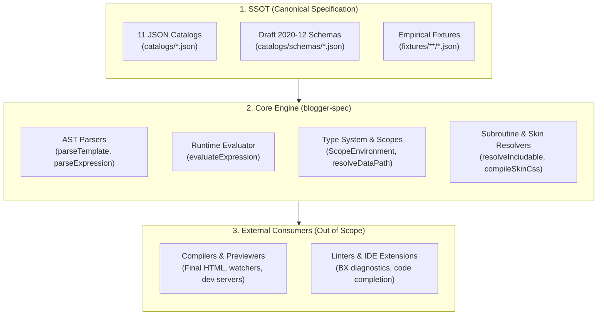

# Blogger Spec Documentation

> Central guide and information architecture for `blogger-spec`: normative authority, canonical catalog, and parsing engine for Blogger XML templates and expressions.

---

## 1. System Conceptual Map

`blogger-spec` acts as the **Single Source of Truth (SSOT)** and the formal parsing and typing engine for the Blogger XML ecosystem. It provides all necessary primitives so external tools (compilers, linters, previewers, IDE extensions) share a single, empirically verified understanding of the language.

---

## 2. Documentation Index

The documentation is organized across three tiers of progressive disclosure:

### 2.1. Architecture & Fundamentals
- [**Architecture Overview**](architecture/overview.md): Architectural boundary, structure of the 11 canonical catalogs, artifact generation, and zero-runtime-dependency invariants.

### 2.2. Normative Language Specifications
- [**Layouts v3 Render Pipeline**](spec/render-pipeline.md): Prescriptive specification of the 5 execution phases, DOM mutation hoisting (`b:class`, `b:attr`), the pseudo-attribute `b:whitespace='remove'`, and hierarchical subroutine dispatch (`resolveIncludable`).
- [**Expression Language**](spec/expression-language.md): Dual syntax (infix vs. functional), collections and lambdas, 10-level Pratt precedence, canonical relaxed equality, and token budget limits (`BX1021`).
- [**Type System & Data Model**](spec/type-system-and-data.md): Platform type ontology, strict isolation of Theme Designer variables (`skin:*`), type modifiers, deep traversal with `resolveDataPath`, and lexical scope resolution (`ScopeEnvironment`).
- [**Directives & XML Markup**](spec/directives-and-markup.md): Symbolic content models (`@flow_instructions`, etc.), recovery policies for invalid nesting (`BX1035`), CDATA handling, and nuances across Layout versions (v1, v2, v3).

### 2.3. Practical Integration Guides
- [**Building a Local Compiler**](guides/compiler-authoring.md): Step-by-step guide to architecting and implementing a compilation engine or preview server using `blogger-spec` as a library and authority.
- [**Conformance & Testing**](guides/conformance-and-testing.md): Certifying an external engine using the conformance runner (`runConformance`), the `BloggerFixture` contract, and contributing empirical fixtures.

---

## 3. Routing Guide by Intent

Use this reference table to quickly locate the technical documentation you need:

| I need to understand or implement... | Canonical Document | SSOT Catalogs / Sources |
| :--- | :--- | :--- |
| **How to build a local compiler or previewer** | [`guides/compiler-authoring.md`](guides/compiler-authoring.md) [`spec/render-pipeline.md`](spec/render-pipeline.md) | `catalogs/directives.json` `catalogs/inclusions.json` |
| **How expressions and operators are evaluated** | [`spec/expression-language.md`](spec/expression-language.md) | `catalogs/operators.json` `catalogs/diagnostics.json` |
| **Data path navigation (`data:*`, `skin.vars`)** | [`spec/type-system-and-data.md`](spec/type-system-and-data.md) | `catalogs/types.json` `catalogs/globals.json` `catalogs/scopes.json` |
| **`<b:include>` dispatch hierarchy and subroutines** | [`spec/render-pipeline.md`](spec/render-pipeline.md) | `catalogs/directives.json` `catalogs/inclusions.json` |
| **Compiling `<b:skin>` and compound fonts** | [`spec/render-pipeline.md`](spec/render-pipeline.md) [`guides/compiler-authoring.md`](guides/compiler-authoring.md) | `catalogs/directives.json` `catalogs/types.json` |
| **Directive validation and allowed nesting** | [`spec/directives-and-markup.md`](spec/directives-and-markup.md) | `catalogs/directives.json` `catalogs/widgets.json` |
| **Certifying compatibility of my engine with Blogger** | [`guides/conformance-and-testing.md`](guides/conformance-and-testing.md) | `fixtures/index.json` `fixtures/contexts/*.json` |

---

## 4. Golden Rules for Humans and LLMs

1. **Documentation explains concepts; catalogs store data:** Do not duplicate static tables of operators, directives, or diagnostics in Markdown. The exhaustive and up-to-date reference lives in the `catalogs/*.json` files.
2. **No empirically unproven inferences:** Every compilation rule or diagnostic must be backed by a fixture in `fixtures/` verified against Blogger's production engine.
3. **Separation of concerns:** `blogger-spec` provides ASTs, types, validation, and atomic expression evaluation. Generating final HTML DOM and managing local development servers is the sole responsibility of the consuming project.
