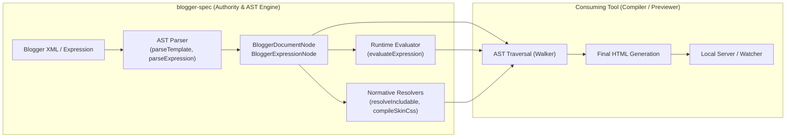
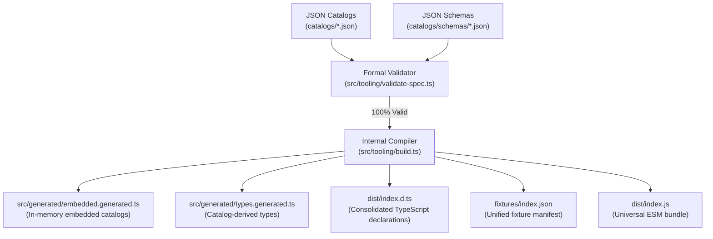

# Architecture Overview

> Design principles, architectural boundaries, the SSOT model, and the compilation pipeline of `blogger-spec`.

---

## 1. Architectural Boundary

`blogger-spec` is designed with a strict delimitation of responsibilities. It does not attempt to be a web server, a static site generator, or a monolithic clone of Google infrastructure. It is the **normative specification authority, AST parser, and expression evaluation engine**.

### 1.1. What `blogger-spec` provides
- **Strongly typed AST models:** Transforms Blogger XML and expressions into formal in-memory representations (`BloggerDocumentNode`, `BloggerExpressionNode`).
- **Atomic runtime evaluation:** Evaluates expressions with canonical relaxed equality (`isEqual`), null-safety, and collection lambdas (`filter`, `map`).
- **Hierarchical subroutine resolution:** Determines the exact includable to dispatch following the 6-tier ontological hierarchy (`resolveIncludable`).
- **Theme Designer skin compiler:** Extracts variables, decomposes compound fonts, and substitutes `$(...)` syntax within `<b:skin>` (`compileSkinCss`).
- **Canonical mock contexts:** 12 pre-built canonical views (`getMockContext`) validated under Draft 2020-12 schemas.
- **Conformance suite and test harness:** Universal test runner (`runConformance`) backed by 300+ empirical fixtures verified against Blogger's production engine.

### 1.2. What is delegated to the consumer
- **Tree traversal (AST Walker):** Assembling the resulting DOM from the AST is the responsibility of the external compiler or rendering engine (conforming to [`render-pipeline.md`](../spec/render-pipeline.md)).
- **Development servers and watchers:** Local HTTP servers, live-reload mechanisms, and browser previewers.
- **Proprietary Google services:** Authenticated dynamic comments, captcha verification, server-side AdSense injection, and live analytics.

---

## 2. The Single Source of Truth (SSOT)

All domain knowledge for the Blogger language resides in **11 Master JSON Catalogs** located in `catalogs/`. Source code in `src/` implements execution algorithms and analysis logic, but **never hardcodes domain metadata**.

| Catalog | Normative Responsibility |
| :--- | :--- |
| `directives.json` | `b:*` directives, permitted attributes, closure modes, nesting rules, DOM mutation pipelines, and Layout versions (v1, v2, v3). |
| `operators.json` | Expression operators, 10-level Pratt precedence hierarchy, dual syntax (infix/functional), and token budget costs. |
| `types.json` | Type system ontology, applicable modifiers, platform subtypes, `skin:*` isolation, and truthiness/coercion matrix. |
| `widgets.json` | Official gadget types (`Blog`, `Header`, `HTML`, etc.), permitted sections, and associated data schemas. |
| `settings.json` | Allowed settings and dictionaries in `<b:widget-settings>`. |
| `globals.json` | Global objects available in templates (`blog`, `view`, `skin`), view flags, and endpoint matrices. |
| `messages.json` | Canonical identifiers for localized UI strings (`data:messages.*`). |
| `scopes.json` | Visibility rules, resolution precedence (`lambda` $\to$ `global`), and identifier shadowing policies. |
| `diagnostics.json` | Unified registry of compiler diagnostics (`BX1001`–`BX1062`), severity levels, and error message templates. |
| `inclusions.json` | Server platform subroutines and macros (`all-head-content`, etc.) along with their normative local stubs. |
| `locales.json` | Supported language metadata, BCP 47 codes, and regional format rules. |

### 2.1. Strict Validation with JSON Schema (Draft 2020-12)
Each catalog has a formal validation schema in `catalogs/schemas/*.schema.json`. The tooling pipeline validates that no property or cross-reference escapes the defined contracts.

---

## 3. Artifact Generation Pipeline and Freshness

`blogger-spec` generates optimized in-memory artifacts for universal execution. To ensure reproducibility and keep version control clean, two fundamental rules apply:

1. **Generated artifacts are never edited by hand:** The `dist/` directory, `src/generated/` directory, and `fixtures/index.json` file are ignored by Git (`.gitignore`).
2. **Automatic generation via `prepare` / `build`:** Compiled via `pnpm run build` or upon running `pnpm install`.

---

## 4. Zero Runtime Dependencies Invariant

The package exports a pure, self-contained runtime:
- **`"dependencies": {}`:** `package.json` strictly maintains zero production runtime dependencies.
- **Node.js proprietary API independence:** The engine does not rely on `node:fs` or `node:path` in its primary universal export. All catalogs are pre-hydrated in memory (`MemoryCatalogStore`), allowing `blogger-spec` to run across web browsers, Cloudflare Workers, V8 isolates, Deno, and Node.js seamlessly.
- **Optional filesystem access:** A dedicated subpath (`blogger-spec/node`) is provided for Node.js environments requiring dynamic catalog reloads from disk (`FsCatalogStore`).

---

## 5. Hermetic Verification Loop

To ensure repository integrity across every modification, a mandatory verification suite runs via `pnpm run verify`:

1. **`pnpm run check:hermetic`:** Verifies test isolation and the absolute absence of unversioned local paths or couplings.
2. **`pnpm run test:spec`:** Executes formal validation of all catalogs and mock contexts against their Draft 2020-12 JSON schemas, verifies cross-referential integrity (`BX` codes, types, directives), and confirms `.d.ts` freshness.
3. **`pnpm run typecheck`:** Strict TypeScript check (`tsc --noEmit`) with strict typing enabled.
4. **`pnpm run lint`:** ESLint format and style validation (`@antfu/eslint-config`).
5. **`pnpm run test`:** Full execution of unit and conformance test suites in Vitest (500+ automated tests).
