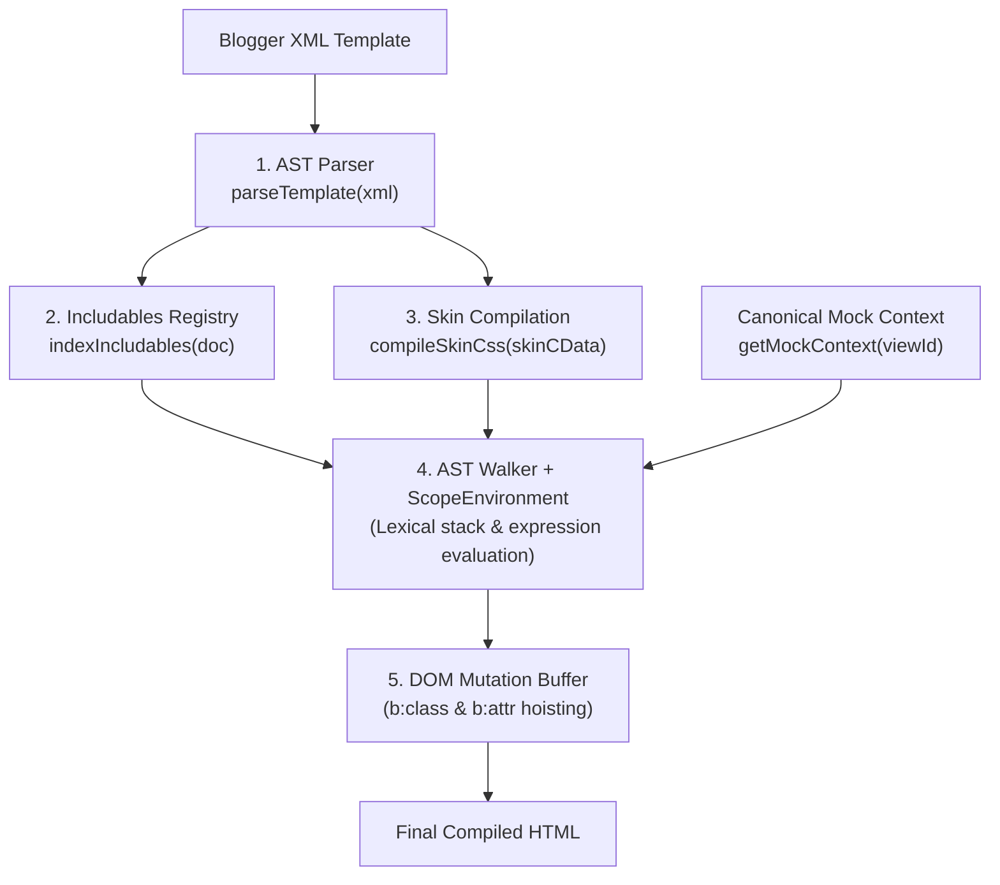
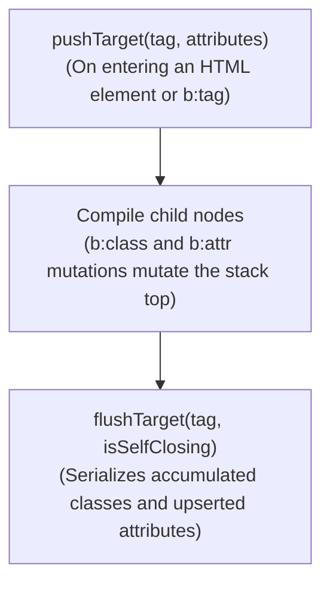

# Guide to Building a Local Blogger Compiler

> Prescriptive guide for architecting and implementing a local HTML compiler or previewer powered by `blogger-spec`.

---

## 1. Conforming Compiler Architecture

`blogger-spec` provides syntax parsing (AST), expression evaluation, subroutine resolution, and skin stylesheet compilation. The responsibility of walking the AST, maintaining the DOM mutation buffer, and emitting final HTML belongs to the **consuming compiler**.



---

## 2. Step-by-Step Implementation

### Step 1: Parsing the Template into an AST
The compiler reads the XML source and converts it into a `BloggerDocumentNode` tree.

```typescript
import { parseTemplate } from 'blogger-spec'

const doc = parseTemplate(xmlSource, {
  tolerant: false, // Strict Blogger XML mode
  parseExpressions: true, // Parse dynamic expressions into expression ASTs
})

if (doc.diagnostics && doc.diagnostics.length > 0) {
  // Handle parser warnings or recoverable diagnostics
  console.warn('Parser diagnostics:', doc.diagnostics)
}
```

---

### Step 2: Indexing and Subroutine Registration (`indexIncludables`)
Before rendering widgets, index all global `<b:defaultmarkup>` blocks and local widget `<b:includable>` subroutines.

```typescript
import { indexIncludables, resolveIncludable } from 'blogger-spec'

// 1. Index the template
const registry = indexIncludables(doc)

// 2. Resolve an inclusion inside a widget
const resolved = resolveIncludable('post:card', 'Blog1', 'Blog', registry)

if (resolved.source === 'unresolved') {
  // Emit official Blogger error comment (BX1037)
  console.error(resolved.abortComment)
}
```

Resolution automatically enforces the 6-tier hierarchy (`local_widget` $\to$ `gadget_specific` $\to$ `universal_widget` $\to$ `shared_common` $\to$ `platform_server` $\to$ `unresolved`) and the `last_block_wins` rule.

---

### Step 3: Compiling `<b:skin>` and Extracting Variables
The compiler locates `<b:skin>` (or `<b:template-skin>`), processes its typed variables, and generates clean CSS ready for injection into `<head>`.

```typescript
import { compileSkinCss } from 'blogger-spec'

// Extract CDATA from <b:skin>
const skinNode = findDirective(doc, 'b:skin')
const skinCData = extractCData(skinNode)

const skinResult = compileSkinCss(skinCData, {
  wrap: 'page-skin', // Generates <style id='page-skin-1' type='text/css'><!-- ... --></style>
  stripMetadataTags: true, // Strips <Variable> and <Group> from output CSS
  overrides: {
    'body.background': '#ffffff', // Allows preview overrides injection
  },
})

// skinResult.css -> Compiled CSS wrapped in style tags
// skinResult.variables -> Resolved variable map for data:skin.vars.*
```

---

### Step 4: Initializing Data Context and Scopes
Select the target view to simulate (e.g. `post`, `homepage`, `static_page`) using canonical mock data:

```typescript
import { getMockContext, ScopeEnvironment } from 'blogger-spec'

// 1. Load context for the selected view
const mockContext = getMockContext('post', {
  blog: { title: 'My Test Blog' },
})

// 2. Enrich with compiled skin variables
mockContext.skin = {
  vars: skinResult.variables,
}

// 3. Initialize the lexical scope stack
const scopeEnv = new ScopeEnvironment()
scopeEnv.pushScope('global', { symbols: mockContext })
```

---

### Step 5: Implementing the AST Walker and DOM Mutation Buffer

The core of the compiler walks AST nodes. To apply continuous mutation directives (`b:class`, `b:attr`), the compiler must manage a mutation stack:



#### Normative Buffer Rules:
1. **Transparent Containers (`b:if`, `b:loop`, `b:with`):** Do not call `pushTarget`. Any `<b:class>` or `<b:attr>` emitted inside them pierces through the container (*continuous hoisting*) and mutates the active HTML element at the top of the stack.
2. **`b:tag cond='false'`:** When the condition evaluates to false, the HTML tag is omitted but its children compile normally; any nested `<b:class>` or `<b:attr>` hoists to the parent container.
3. **Pseudo-Attribute `b:whitespace='remove'`:** When a void element (`<input>`, ``, etc.) contains `b:whitespace='remove'`, the attribute is suppressed from output and the tag is formatted cleanly as self-closing XML:
   ```html
   
   ```

---

## 3. Minimal Reference Compiler

The following is a minimal functional compiler illustrating complete integration:

```typescript
import type {
  BloggerDirectiveNode,
  BloggerElementNode,
  BloggerTemplateNode,
} from 'blogger-spec'
import {
  compileSkinCss,
  evaluateExpression,
  getMockContext,
  indexIncludables,
  parseTemplate,
  resolveIncludable,
  ScopeEnvironment,
} from 'blogger-spec'

export class SimpleBloggerCompiler {
  private scope = new ScopeEnvironment()
  private classStack: string[][] = []
  private attrStack: Array<Record<string, string>> = []

  compile(xml: string, viewId = 'homepage'): string {
    const doc = parseTemplate(xml)
    const registry = indexIncludables(doc)
    const context = getMockContext(viewId)

    this.scope = new ScopeEnvironment()
    this.scope.pushScope('global', { symbols: context })

    return this.walkNodes(doc.children, registry)
  }

  private walkNodes(nodes: readonly BloggerTemplateNode[], registry: any): string {
    let out = ''
    for (const node of nodes) {
      out += this.walkNode(node, registry)
    }
    return out
  }

  private walkNode(node: BloggerTemplateNode, registry: any): string {
    switch (node.type) {
      case 'Text':
        return node.value

      case 'Element':
        return this.renderElement(node, registry)

      case 'Directive':
        return this.renderDirective(node, registry)

      default:
        return ''
    }
  }

  private renderElement(elem: BloggerElementNode, registry: any): string {
    this.classStack.push(elem.attributes.class?.value ? [elem.attributes.class.value] : [])
    this.attrStack.push({})

    const innerHtml = this.walkNodes(elem.children, registry)

    const accumulatedClasses = this.classStack.pop()!.join(' ').trim()
    const upsertedAttrs = this.attrStack.pop()!

    const attrs = { ...elem.attributes, ...upsertedAttrs }
    if (accumulatedClasses) {
      attrs.class = { name: 'class', value: accumulatedClasses } as any
    }

    const attrStr = Object.values(attrs)
      .filter(a => a.value !== '' && a.value !== undefined && a.name !== 'b:whitespace')
      .map(a => ` ${a.name}="${a.value}"`)
      .join('')

    return elem.selfClosing ? `<${elem.name}${attrStr}/>` : `<${elem.name}${attrStr}>${innerHtml}</${elem.name}>`
  }

  private renderDirective(dir: BloggerDirectiveNode, registry: any): string {
    switch (dir.name) {
      case 'b:if': {
        const condNode = dir.attributes.cond?.expression
        const isTrue = condNode ? evaluateExpression(condNode, this.scope.currentContext) : false
        return isTrue ? this.walkNodes(dir.children, registry) : ''
      }

      case 'b:class': {
        const name = dir.attributes.name?.value
        if (name && this.classStack.length > 0) {
          this.classStack[this.classStack.length - 1]!.push(name)
        }
        return ''
      }

      case 'b:attr': {
        const name = dir.attributes.name?.value
        const value = dir.attributes.value?.value ?? ''
        if (name && this.attrStack.length > 0) {
          this.attrStack[this.attrStack.length - 1]![name] = value
        }
        return ''
      }

      default:
        return this.walkNodes(dir.children, registry)
    }
  }
}
```

---

## 4. Server Stub Injections

In production templates, subroutines like `<b:include data='blog' name='all-head-content'/>` attempt to load scripts and metadata from Blogger servers.

For hermetic, local compilation:
1. Use `getLocalStubInclusion('all-head-content')` exported by `blogger-spec/inclusion-expander`.
2. The compiler substitutes the server macro with standard Blogger head metadata (charset, viewport, favicons, canonical link) without requiring network connectivity.
