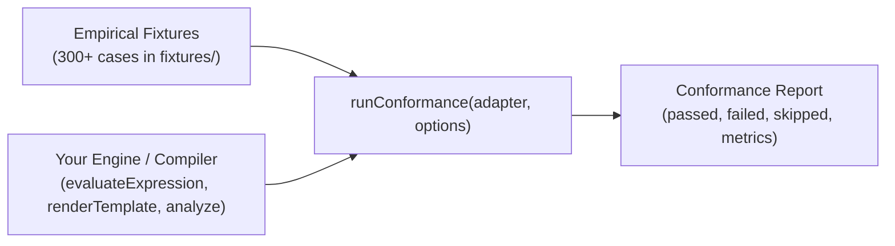

# Conformance and Empirical Testing Guide

> How to certify external compilers, evaluators, and linters using the conformance test harness (`blogger-spec/runner`), and how to contribute empirical fixtures to the repository.

---

## 1. The Conformance Harness (`runner`)

`blogger-spec` includes a universal test runner (`runConformance` and `runSpecConformance`) designed to validate external implementations against Blogger's official standard without coupling to any specific test framework.



---

## 2. Implementing a Conformance Adapter

To certify your tool, provide an adapter object implementing one or more evaluation methods:

```typescript
import type { BloggerConformanceAdapter } from 'blogger-spec/runner'
import { runConformance } from 'blogger-spec/runner'

// Implement methods supported by your tool:
const adapter: BloggerConformanceAdapter = {
  // For expression evaluators
  evaluateExpression: (exprSource, context) => {
    return myCustomEngine.eval(exprSource, context)
  },

  // For template compilers
  renderTemplate: (templateSource, context) => {
    return myCustomCompiler.render(templateSource, context)
  },

  // For linters and static analyzers
  analyze: (sourceCode) => {
    const diagnostics = myLinter.lint(sourceCode)
    return diagnostics.map(d => ({ code: d.ruleCode }))
  },
}

// Run the complete fixture suite
const report = runConformance(adapter)

console.log(`Conformance: ${report.passed} of ${report.total} tests passed.`)
if (report.failed > 0) {
  console.error('Conformance failures detected:', report.results.filter(r => !r.passed))
}
```

---

## 3. Filtering and Normalization Options

The test harness allows executing specific subsets of the suite:

```typescript
const report = runConformance(adapter, {
  // Filter by input type
  filter: {
    kind: 'template', // 'expression' | 'template'
    evidence: ['official'], // 'official' | 'observed'
    covers: ['operator:resizeImage', 'tag:b:if'], // Filter by capability
  },

  // Custom HTML normalizer (defaults to normalizeHtmlString)
  normalizeHtml: html => html.replace(/\s+/g, ' ').trim(),
})
```

### 3.1. Canonical HTML Normalization (`normalizeHtmlString`)
When comparing template outputs (`outcome: 'html'`), the harness uses `normalizeHtmlString` to:
- Collapse insignificant whitespace between HTML tags.
- Normalize quotation marks and empty boolean attributes (`required=""` $\to$ `required`).
- Guarantee that cosmetic whitespace differences do not produce false negatives.

---

## 4. Formal Fixture Contract (`BloggerFixture`)

Every test case in `fixtures/**/*.json` must strictly comply with the Draft 2020-12 schema (`catalogs/schemas/fixture.schema.json`).

```json
{
  "id": "templates/prod_fragments/post_card",
  "title": "Production Post Card with Image Resizing",
  "evidence": "official",
  "covers": [
    "subsystem:prod_fragments",
    "tag:b:if",
    "operator:resizeImage",
    "tag:data:*"
  ],
  "input": {
    "kind": "template",
    "source": "<article class='card'><b:if cond='data:post.featuredImage'></b:if></article>",
    "mode": "fragment",
    "context": {
      "post": {
        "featuredImage": "https://blogger.googleusercontent.com/img/a/AVvXsEjxyz=s1600"
      }
    }
  },
  "expected": {
    "outcome": "html",
    "html": "<article class=\"card\"></article>",
    "canonicalDom": true
  },
  "verified_at": "2026-10-28"
}
```

### 4.1. Mandatory Prefixes in `covers`
Each entry in the `covers` array must explicitly identify the subsystem or element under test:
- `tag:` XML directives (e.g. `tag:b:if`, `tag:b:loop`, `tag:b:tag`).
- `operator:` Expression operators (e.g. `operator:resizeImage`, `operator:?:`).
- `type:` Data types (e.g. `type:string`, `type:image`).
- `modifier:` Computed modifiers (e.g. `modifier:escaped`, `modifier:isResizable`).
- `rule:` Normative diagnostic codes (e.g. `rule:BX1021`, `rule:BX1035`).
- `subsystem:` Major modules defined in `catalogs/diagnostics.json` (`domain_metadata.subsystems`).

---

## 5. Empirical Fixture Contribution Workflow

To maintain the authority of `blogger-spec`, **no fixture is added based on assumptions or outdated documentation**. The normative workflow is:

1. **Empirical Production Evidence:**
   - The behavior must be observed in Blogger's actual engine by installing a test template or inspecting raw captures in `.workbench/captures/raw/`.
2. **Fixture Creation:**
   - Add the test case in the appropriate category within `fixtures/` (`expressions/`, `templates/`, `diagnostics/`).
3. **Rebuilding the Global Manifest:**
   - Run `pnpm run build` to automatically synchronize `fixtures/index.json`.
4. **Automated Validation:**
   - Run `pnpm run test:spec` to verify that the fixture satisfies the JSON schema and that all identifiers in `covers` exist in the canonical catalogs.
