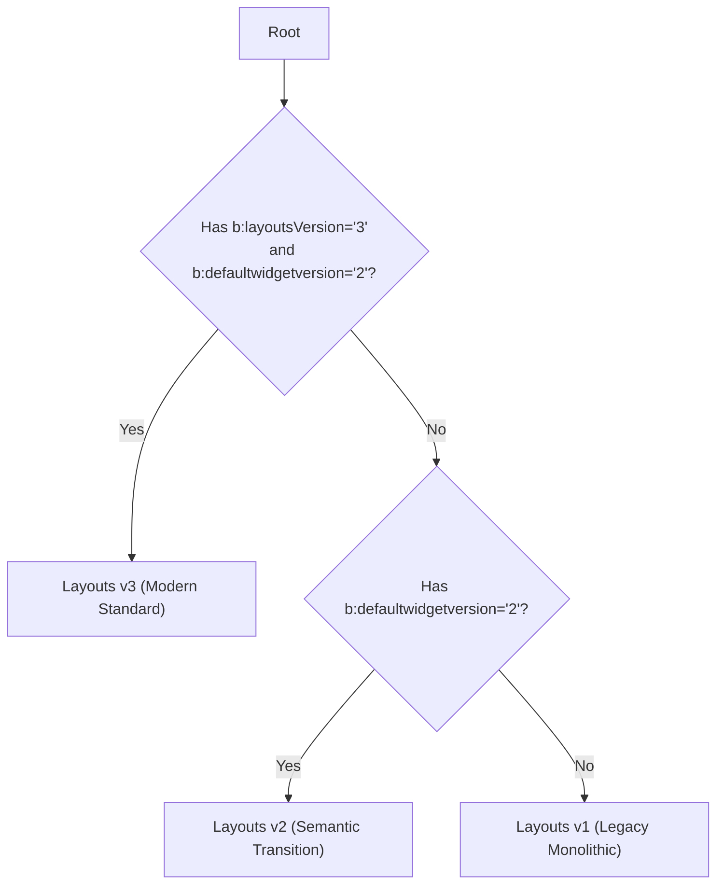

# Blogger Directives and XML Markup Specification

> Formal grammar of `b:*` directives, content models, invalid nesting policies, void elements, and Layout versioning (v1, v2, v3).

---

## 1. XML Namespace and Directive Classification

All Blogger template directives reside in the official XML namespace:
```xml
xmlns:b='http://www.google.com/2005/gml/b'
```

Directives are functionally divided into six canonical categories governed by `catalogs/directives.json`:

| Category | Directives | Role in Template |
| :--- | :--- | :--- |
| **Structural** | `b:section`, `b:widget`, `b:includable`, `b:include`, `b:defaultmarkups`, `b:defaultmarkup`, `b:widget-settings`, `b:widget-setting` | Defines container architecture, subroutines, and gadget configuration. |
| **Control Flow** | `b:if`, `b:elseif`, `b:else`, `b:switch`, `b:case`, `b:default`, `b:loop`, `b:with` | Conditional branching, iteration loops, and local variable scoping. |
| **DOM Mutation** | `b:tag`, `b:class`, `b:attr` | Dynamic manipulation of HTML tag names, accumulated classes, and attributes. |
| **Interpolation** | `data:*`, `b:eval`, `b:message` | Server data emission, expression evaluation to text, and localized strings. |
| **Styles** | `b:skin`, `b:template-skin` | CDATA blocks containing CSS and Theme Designer variables (`<Variable>`, `<Group>`). |
| **Metadata** | `b:param`, `b:comment` | Formal subroutine parameters and conditional comments processed by the engine. |

---

## 2. Symbolic Content Models

To validate parent-child relationships without rigid code coupling, the specification uses **symbolic content groups**:

- **`@flow_instructions`:** Non-container or self-closing flow instructions (`b:include`, `b:eval`, `b:message`, `data:*`, `b:param`).
- **`@flow_containers`:** Directives wrapping blocks of markup (`b:if`, `b:loop`, `b:with`, `b:switch`, `b:tag`).
- **`@template_markup`:** Standard HTML tags (`<div>`, `<article>`, etc.), free text nodes, and CDATA sections.
- **`@theme_containers`:** Root containers where theme design markup is permitted (`<head>`, `<html>`).
- **`@any_container`:** Any container directive or structural element.

### 2.1. Declarative Validation with `canNest`
Nesting rules reside in `directives.json` (`valid_parents` and `valid_children`). They are evaluated via the public API:

```typescript
import { canNest } from 'blogger-spec/parser'

canNest('b:section', 'b:widget') // true
canNest('b:widget', 'b:includable') // true
canNest('head', 'b:section') // false (BX1035)
canNest('b:widget', 'b:section') // false (BX1035: sections cannot nest inside widgets)
```

---

## 3. Invalid Nesting Policies and Recovery Actions

When an element appears within an unauthorized parent, the specification defines a declarative policy (`invalid_nesting_policy`) with one of three recovery actions:

1. **`reject` (Fatal):** Immediate compilation failure. Produces a fatal diagnostic and halts processing.
   - *Example:* `<b:section>` nested inside another `<b:section>`, inside a widget, or inside `<head>` (`BX1035`).
2. **`strip` (Prune):** The directive or tag is removed from the output, but its inner content may be unwrapped or discarded depending on context.
   - *Example:* `<b:skin>` placed incorrectly inside `<body>` or inside a widget (`BX1023`).
3. **`ignore` (Skip):** The node is silently ignored without aborting execution.

---

## 4. Critical Structural Constraints

### 4.1. Sections (`b:section`)
- **Valid parents:** `<body>`, `<b:tag>`, structural HTML elements (`html:*`), and conditional root containers (`<b:if>`, `<b:with>`).
- **Forbidden:** Cannot nest inside `<head>`, inside `<b:widget>`, inside loops (`<b:loop>`), or inside other sections (`BX1035`).
- **Mandatory attribute:** Requires a unique `id` attribute across the document.

### 4.2. Widgets (`b:widget`)
- **Mandatory parent:** Must reside directly inside a `<b:section>`.
- **Mandatory attributes:** `id` (unique across the theme) and `type` (one of the canonical gadget types in `catalogs/widgets.json`: `Blog`, `Header`, `HTML`, `LinkList`, `FeaturedPost`, etc.).
- **Direct children:** The only permitted first-level direct children are `<b:widget-settings>` and `<b:includable>` subroutines.

### 4.3. Subroutines (`b:includable`)
- **Valid containers:** Directly under `<b:widget>` (private) or under `<b:defaultmarkup>` inside `<b:defaultmarkups>` (shared).
- **Main subroutine:** Every widget must declare at least one `<b:includable id='main'>`, which serves as the primary rendering entry point.

---

## 5. Blogger Layout Versions (v1, v2, v3)

The Blogger engine has evolved across three template architecture generations. `blogger-spec` detects the version via `detectTemplateVersion(xmlText)`:



### Architecture Comparison Table

| Feature | Layouts v1 | Layouts v2 | Layouts v3 (Prescriptive) |
| :--- | :--- | :--- | :--- |
| **Mandatory root attributes** | None | `b:defaultwidgetversion='2'` | `b:layoutsVersion='3'`<br>`b:defaultwidgetversion='2'` |
| **Server CSS/JS suppression** | Not supported | Optional | Mandatory: `b:css='false'`, `b:js='false'` |
| **Shared subroutines** | Not supported | `<b:include name='super.*'/>` | Hierarchical `<b:defaultmarkups>` (6 tiers) |
| **Widget HTML output** | Heavy server-injected tables (`<table>`, `<tr>`) | Semantic HTML | Stripped clean, fully theme-governed |
| **`<b:template-skin>` tag** | Forbidden (fatal error) | Permitted | Permitted (isolated with `data:view.isLayoutMode`) |
| **Quickedit support** | Automatic via server | Deprecated | Forbidden / Obsolete |

---

## 6. XML Nuances: Void Elements and `b:whitespace`

Unlike permissive HTML, Blogger templates are parsed under well-formed XML rules.

### 6.1. Void Elements
In strict XML, void tags such as `<input>`, ``, `<hr>`, and `<br>` must be explicitly closed (`` or `</img>` with empty content). To bind directives like `<b:class>` or `<b:attr>` to a void element, modern templates use dynamic containers:

```xml
<b:tag name='input'>
  <b:attr name='b:whitespace' value='remove'/>
  <b:attr name='type' value='text'/>
  <b:class name='form-input'/>
  <b:attr name='value' expr:value='data:inputValue'/>
</b:tag>
```

### 6.2. The Pseudo-Attribute `b:whitespace='remove'`
When attached to an HTML element or `<b:tag>` directive:
1. Strips all trailing whitespace before closing.
2. Is suppressed from the final output (never emitted to HTML).
3. Enforces clean, canonical self-closing XML:
   ```html
   <input type="text" class="form-input" value="Draft"/>
   ```
