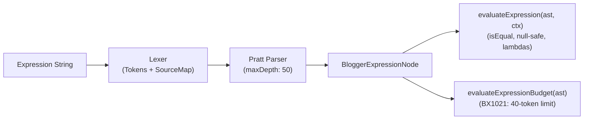

# Blogger Expression Language Specification

> Formal grammar, Pratt precedence hierarchy, dual syntax, collection lambdas, runtime semantics, and compiler token budget (`BX1021`).

---

## 1. Expression Engine Overview

Dynamic Blogger expressions (`expr:*`, `cond`, `values`, `value`) are evaluated by a two-stage engine:
1. **Lexical and Syntactic Analysis (Parser):** A deterministic lexer (`src/parser/lexer.ts`) followed by a Pratt parser (`src/parser/expr-parser.ts`) structured around the canonical precedence table in `catalogs/operators.json`.
2. **Runtime Evaluation / Static Analysis:** The evaluator (`src/parser/expr-evaluator.ts`) resolves ASTs safely with null tolerance, while the quota calculator (`src/quota.ts`) verifies that expressions do not exceed compiler limits.



### Engine Invariants
- **Recursion Depth Limit:** The parser enforces a strict recursion limit of `maxDepth: 50` to prevent call stack exhaustion (`RangeError`) in both strict and tolerant modes.
- **Zero Runtime Dependencies:** Lexing, parsing, and evaluation operate entirely on in-memory data structures without external dependencies.

---

## 2. Dual Syntax: Infix and Functional

Blogger supports two syntactic styles for many operations: **infix** (fluent template style) and **functional** (classic function call style).

| Operation | Infix Syntax | Equivalent Functional Syntax | Description |
| :--- | :--- | :--- | :--- |
| **Membership / Contains** | `data:post.labels contains "News"` | `contains(data:post.labels, "News")` | Checks whether an element belongs to a collection or substring. |
| **Inverse Membership** | `"News" in data:post.labels` | `in("News", data:post.labels)` | Checks whether the left value resides within the right collection. |
| **CDN Image Resizing** | `data:post.featuredImage resizeImage 400` | `resizeImage(data:post.featuredImage, 400)` | Applies Google CDN scaling and cropping parameters (`=w400-h...`). |
| **Append URL Parameters** | `data:blog.url params { m: "1" }` | `params(data:blog.url, { m: "1" })` | Appends query parameters while preserving URL encoding. |
| **Date Formatting** | `data:post.date format "yyyy-MM-dd"` | `format(data:post.date, "yyyy-MM-dd")` | Applies a locale-aware date-time formatting mask. |

> [!NOTE]
> Purely arithmetic operators (`+`, `-`, `*`, `/`, `%`) and logical operators (`and`, `or`, `?:`) are only available in infix form. Certain operators like `sourceSet(...)` operate exclusively in functional form.

---

## 3. Collections and Lambda Expressions

The engine supports processing pipelines over collections (`arrays`) using higher-order functions:

```text
data:posts filter (p => p.labels any (l => l.name == "Featured"))
```

### 3.1. Supported Collection Operators
- `filter`: Returns a new array with elements satisfying the predicate.
- `map`: Transforms each element according to the return expression.
- `any`: Returns `true` if at least one element satisfies the condition.
- `all`: Returns `true` if all elements satisfy the condition.
- `none`: Returns `true` if no elements satisfy the condition.
- `count`: Counts elements that satisfy the predicate.
- `first`: Returns the first element satisfying the condition, or the first item of the array.

### 3.2. Lambda Iterator Normative Rule (`BX1019`)
The iteration identifier in a lambda is a purely local lexical variable:
- **Valid:** `data:items filter (x => x.active)`
- **Forbidden (`BX1019`):** `data:items filter (data:x => data:x.active)`
- **Technical rationale:** In Blogger, lambda iterators do not belong to the server data namespace (`data:`). Using `data:` in a lambda parameter results in an immediate compilation error.

---

## 4. Precedence Hierarchy and Associativity

The Pratt parser resolves operator precedence across 11 normative levels per `catalogs/operators.json`:

| Level | Category | Associativity | Representative Operators |
| :---: | :--- | :---: | :--- |
| **1** | Grouping | Inner-to-outer | `( ... )`, function calls, index access `[i]` |
| **2** | Coalescence / Primary Elvis | Right-to-left | `?:` (fallback coalescence) |
| **3** | Multiplicative Arithmetic | Left-to-right | `*`, `/`, `%` |
| **4** | Additive Arithmetic & Transforms | Left-to-right | `+`, `-`, `resizeImage`, `params`, `format`, `snippet` |
| **5** | Relational Comparisons & Slices | Left-to-right | `==`, `!=`, `<`, `>`, `<=`, `>=`, `take`, `skip`, `to` |
| **6** | Membership & Content | Left-to-right | `in`, `contains`, `not in`, `not contains` |
| **7** | Logical Negation | Right-to-left | `!`, `not` |
| **8** | Logical Conjunction | Left-to-right | `&&`, `and` |
| **9** | Logical Disjunction | Left-to-right | `\|\|`, `or` |
| **10** | Classic Ternary Conditional | Right-to-left | `? :` (`cond ? trueVal : falseVal`) |
| **11** | Collection Pipelines / Lambdas | Left-to-right | `filter`, `map`, `any`, `all`, `none`, `count`, `first` |

---

## 5. Runtime Evaluation Semantics

The evaluator `evaluateExpression(node, context)` applies the equivalence rules of the official engine:

### 5.1. Canonical Relaxed Equality (`isEqual`)
Blogger performs loose equality comparisons tailored to templating:
- `true == "true"` $\to$ `true`
- `false == "false"` $\to$ `true`
- `"" == false` $\to$ `true`
- `0 == "0"` $\to$ `true`

### 5.2. Strict Equality Prohibition and `null` Literals
- **`===` and `!==` (`BX1018`):** The language does not support strict identity operators. Any expression using `===` is rejected by the compiler.
- **Literal `null` (`BX1020`):** Blogger does not recognize `null` as a reserved identifier. To check for missing data, evaluate the identifier's truthiness directly (`b:if cond='data:post.featuredImage'`) or use the `.empty` property.

### 5.3. Truthiness Matrix
A value is considered **falsy** if and only if:
1. It is the boolean `false`.
2. It is an empty string `""`.
3. It is numeric `0` or `NaN`.
4. It is `undefined`, uninitialized, or a non-existent property.
5. It is an empty collection (`array`) where `length == 0`.
Any other value (including empty objects and non-zero numbers) is **truthy**.

---

## 6. Compiler Token Budget (`BX1021`)

The Blogger compiler enforces a syntactic complexity limit per expression: **40 tokens**. Exceeding this limit triggers fatal diagnostic `BX1021`.

### 6.1. Token Counting Rules
The `evaluateExpressionBudget` calculator counts:
- Identifiers and member access paths (e.g. `data:post.title` counts as 1 token per segment).
- Operators and punctuation tokens.
- Numeric, string, and boolean literals.
- Lambda parameter identifiers.

### 6.2. Budget Status Levels
- **`SAFE`:** Total $\le 35$ tokens.
- **`WARNING`:** Between $36$ and $40$ tokens (high risk of regression under subsequent edits).
- **`EXCEEDED`:** $> 40$ tokens (compilation failure `BX1021`).

```typescript
import { evaluateExpressionBudget } from 'blogger-spec/quota'

const report = evaluateExpressionBudget('data:post.labels filter (l => l.name == "News")')
// { totalTokens: 9, isValid: true, status: 'SAFE' }
```
