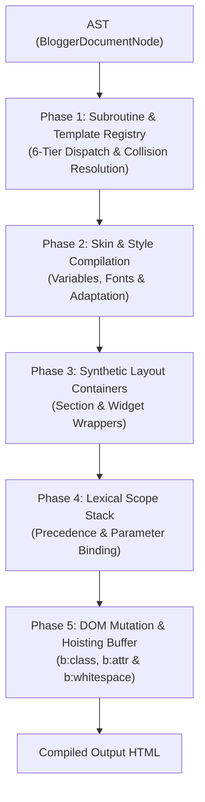
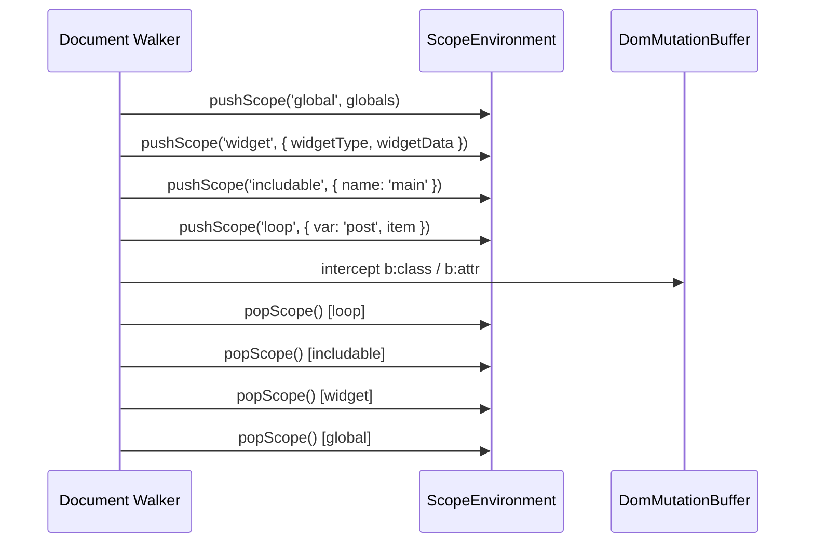

# Blogger Layouts v3 — Template Render Pipeline Specification

**Version:** 1.0.0 (Layouts v3 Prescriptive Standard)  
**Status:** Canonical Normative Specification  
**Authority:** `blogger-spec` Single Source of Truth (SSOT)  

---

## 1. Executive Architecture

The Blogger Layouts v3 template compiler executes an Abstract Syntax Tree (AST) walk using a stateful lexical scope environment and a continuous DOM mutation buffer. Any conforming local compiler or previewer consuming `blogger-spec` must implement this sequential 5-phase execution model.



### Execution Invariants
1. **Target Architecture:** Strictly optimized for **Layouts v3** (`b:layoutsVersion='3'`, `b:defaultwidgetversion='2'`). Monolithic Layouts v1/v2 widgets and tables are deprecated.
2. **Deterministic Evaluation:** All dynamic attributes (`expr:*`, `cond`, `values`, `value`) are evaluated using `evaluateExpression` conforming to Blogger's relaxed equality (`isEqual`), collection lambdas, and null-safety.
3. **Continuous Mutation Hoisting:** DOM attributes and CSS classes emitted via `b:attr` and `b:class` hoist across control boundaries (`b:if`, `b:loop`, `b:with`, `b:tag[cond=false]`) and subroutine boundaries (`b:include`) until attached to the nearest HTML element or synthetic widget wrapper.

---

## 2. Phase 1: Subroutine & Template Registry

Before traversing and rendering widgets, the compiler must scan and index all `<b:defaultmarkup>` blocks and local widget `<b:includable>` blocks to construct the dispatch table.

### 2.1. The 6-Tier Ontological Specificity Chain
Subroutine resolution for `<b:include name='...'>` and `<b:include expr:name='...'>` follows strict descending precedence:

$$\text{Tier 1: local\_widget} \rightarrow \text{Tier 2: gadget\_specific} \rightarrow \text{Tier 3: universal\_widget} \rightarrow \text{Tier 4: shared\_common} \rightarrow \text{Tier 5: platform\_server} \rightarrow \text{Tier 6: unresolved}$$

| Tier | Identifier / Level | Source in Template | Description |
| :---: | :--- | :--- | :--- |
| **1** | `local_widget` | Direct child of `<b:widget>` | Private subroutine defined inside the calling widget. |
| **2** | `gadget_specific` | `<b:defaultmarkup type='WidgetType'>` | Shared default markup matching the specific widget type (or comma-separated multi-type list, e.g. `type='Blog,PopularPosts'`). |
| **3** | `universal_widget` | `<b:defaultmarkup type='All'>` | Universal widget markup applicable across all widget types. |
| **4** | `shared_common` | `<b:defaultmarkup type='Common'>` | Shared cross-cutting subroutines (utility macros, icons, shared components). |
| **5** | `platform_server` | Platform built-in inclusions | Standard server macros (`all-head-content`) and portable platform subroutines. |
| **6** | `unresolved` | Exhaustion of Tiers 1–5 | Resolution failure trigger. |

### 2.2. Collision Handling Semantics
When multiple blocks or subroutines are declared with the same identifier at the same tier:
1. **`last_block_wins`:** If `<b:defaultmarkup type='All'>` is declared multiple times in `<b:defaultmarkups>`, the last declared block completely overrides any previously defined subroutines with matching `id`.
2. **`last_container_wins`:** If identical subroutines exist in duplicate container blocks, the later container declaration takes precedence.

### 2.3. Dynamic Includable Dispatch (`expr:name`) & Abort Policy
When using dynamic expressions in inclusions (e.g. `expr:name='"widget:" + data:widget.type'`):
1. The expression is evaluated against the current runtime context.
2. The evaluated string is queried across Tiers 1 through 5.
3. **Resolution Failure (Tier 6):** If no matching subroutine is found, Blogger **aborts the execution of the entire enclosing widget** and emits the canonical error diagnostic comment (`BX1063`):
   ```html
   <!--Failed to render gadget '[WidgetId]'.

   There was an error processing the markup.
   -->
   ```
   No subsequent instructions of that widget are rendered.

---

## 3. Phase 2: Theme Designer `<b:skin>` Compilation

The `<b:skin>` block contains CSS enriched with Theme Designer tags (`<Variable>`, `<Group>`). The compiler transforms this block into clean, browser-compatible CSS.

### 2.1. Variable Substitution
1. Parse all `<Variable name="..." type="..." default="..." value="..."/>` tags within the CDATA.
2. Determine active value using precedence: `value` over `default`.
3. Replace all variable references matching syntax `$(variable.name)`.
4. Replace dotted names with underscored identifiers for template expression access (`data:skin.vars.body_font`).

### 2.2. Composite Font Variables Decomposition
Variables with `type="font"` decompose into four accessible sub-properties:
- `$(font.name.family)` $\rightarrow$ Font family string.
- `$(font.name.size)` $\rightarrow$ Font size with unit.
- `$(font.name.style)` $\rightarrow$ Font style (`normal`, `italic`).
- `$(font.name.weight)` $\rightarrow$ Font weight (`bold`, `400`, `700`).

### 2.3. Google Fonts Modern Adaptation
In production, Blogger embeds hundreds of lines of `@font-face` definitions. For offline and clean local compilation:
- Identify Google Fonts declared in `type="font"` variables.
- Emit a standard, lightweight stylesheet link into the `<head>` of the document:
  ```html
  <link rel="stylesheet" href="https://fonts.googleapis.com/css?family=Open+Sans:400,700&display=swap"/>
  ```

### 2.4. Tag Stripping & Packaging
1. Strip all `<Variable .../>` and `<Group>...</Group>` tags from the resulting CSS.
2. Package the sanitized CSS into the canonical output tag:
   ```html
   <style id='page-skin-1' type='text/css'><!--
   /* Compiled CSS declarations */
   --></style>
   ```

---

## 4. Phase 3: Synthetic Layout Containers

Blogger layout tags represent synthetic structural markup that expands into HTML elements before children are evaluated.

### 4.1. Sections (`<b:section>`)
1. **Container Element:** Expands to `<div class='section' id='[id]'>`.
2. **Layouts v3 Deprecation Rule:** If a `<b:section>` in Layouts v3 declares `maxwidgets` or `showaddelement`, children widgets are suppressed, and the compiler outputs:
   ```html
   <div class='no-items section' id='[id]'></div>
   ```
3. **Custom Semantic Tag:** If attribute `tag='header'` or `tag='aside'` is declared, the specified HTML tag is emitted instead of `<div>`.

### 4.2. Widgets (`<b:widget>`)
1. **Synthetic Wrapper:** Every widget outputs an outer synthetic wrapper:
   ```html
   <div class='widget [Type]' data-version='2' id='[id]'>
   ```
2. **Runtime Rendering Policy:** If `runtime_rendering_policy: "suppress_when_empty"` and the widget's primary data collection is empty (e.g. `LinkList` with 0 links, `Blog` with 0 posts), the widget wrapper and all contents are completely omitted from the HTML output.
3. **Entry Point Execution:** Render begins by resolving and invoking the widget's `main` includable through Phase 1 dispatch rules.

---

## 5. Phase 4: Lexical Scope Stack & Data Binding

The compiler maintains a strict stack of lexical scope frames adhering to the resolution precedence:

$$\text{lambda} \rightarrow \text{loop} \rightarrow \text{with} \rightarrow \text{includable} \rightarrow \text{widget} \rightarrow \text{global}$$



### 5.1. Scope Frames
- **Global Frame:** Universal properties (`data:blog.*`, `data:view.*`, `data:messages.*`, `data:skin.vars.*`).
- **Widget Frame:** Widget data dictionary properties (`data:title`, `data:posts`, `data:allBylineItems`).
- **`<b:with var='x' value='...'>`:** Creates a local scope frame binding symbol `x`.
- **`<b:loop values='...' var='item' index='i'>`:** Creates a frame binding `item` and 0-based integer `i`.

### 5.2. Parameter Binding without `var` in `<b:include>`
When `<b:include data='...'>` omits the `var` attribute:
1. **Array Payload (`{ [k, v], ... }`):** Binds the array directly to the root identifier `data:` to allow expressions such as `<b:loop values='data:' var='item'>`.
2. **Object Payload (`{ key: value }`):** Unpacks each key into the local scope frame (`<data:key/>` or `data:key`).
3. **Global Fallback:** In both cases, global datasets (`data:blog.*`, `data:view.*`) remain fully accessible as fallbacks.

---

## 6. Phase 5: Continuous DOM Mutation Buffer & Hoisting

Mutations defined by `b:class` and `b:attr` operate continuously on the nearest open HTML ancestor element or widget synthetic wrapper.

### 6.1. Target Resolution & Container Traversal
Mutations hoist transparently through all flow containers:
- `<b:if>`, `<b:elseif>`, `<b:else>`
- `<b:switch>`, `<b:case>`, `<b:default>`
- `<b:with>`
- `<b:loop>`
- `<b:tag cond='false'>` (unwrapping container)
- `<b:include>` (subroutine boundary crossing)

### 6.2. `b:class` Mutation Rules
- **Mode:** `accumulate`.
- **Separator:** Single whitespace (` `).
- **Existing Class Policy:** Preserves any static classes already defined on the HTML tag or synthetic wrapper.
- **Loop Accumulation:** Classes emitted inside loops accumulate across all iterations.

### 6.3. `b:attr` Mutation Rules
- **Mode:** `upsert_or_omit`.
- **Empty Policy:** If the attribute evaluates to an empty string (`""`), `null`, `undefined`, or `MISSING`, the attribute is completely omitted from the HTML tag.
- **Overwrite Policy:** Existing attributes are overwritten by new evaluations. Overwriting the synthetic `id` attribute is explicitly permitted.

### 6.4. Special Pseudo-Attribute `b:whitespace='remove'`
- **Target:** Void HTML elements (`<input>`, ``, `<hr>`, `<br>`).
- **Behavior:** Strips trailing whitespace, suppresses the `b:whitespace` attribute from output, and forces clean XML-compliant self-closing tag syntax:
  ```html
  
  ```

---

## 7. Algorithm Reference: AST Compiler Walk

```typescript
function compileNode(node: BloggerTemplateNode, ctx: CompilerContext): string {
  switch (node.type) {
    case 'Text':
      return node.value

    case 'CData':
      return node.value

    case 'Comment':
      return `<!--${node.value}-->`

    case 'Directive':
      return compileDirective(node, ctx)

    case 'Element':
      return compileElement(node, ctx)
  }
}

function compileElement(elem: BloggerElementNode, ctx: CompilerContext): string {
  ctx.mutationBuffer.pushTarget(elem.name, elem.attributes)

  let innerHtml = ''
  for (const child of elem.children) {
    innerHtml += compileNode(child, ctx)
  }

  const finalizedTag = ctx.mutationBuffer.flushTarget(elem.name, elem.selfClosing)
  return elem.selfClosing ? finalizedTag : `${finalizedTag}${innerHtml}</${elem.name}>`
}
```

