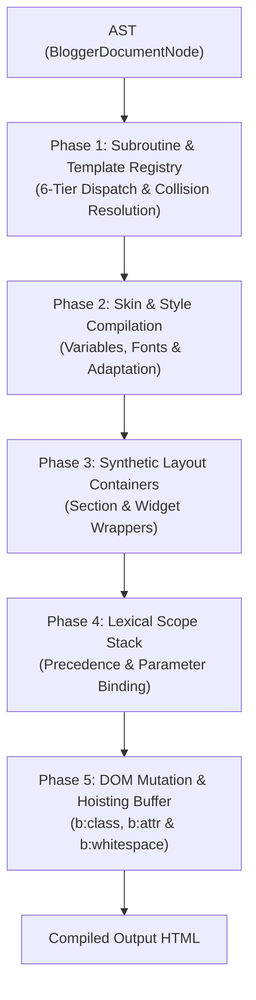
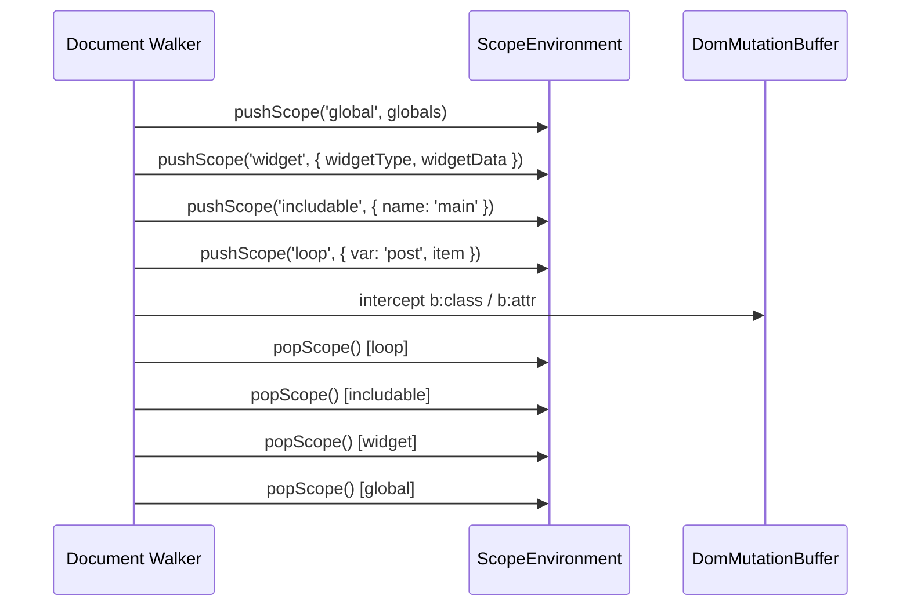

# Blogger Layouts v3 — Template Render Pipeline Specification

**Version:** 1.0.0 (Layouts v3 Prescriptive Standard)  
**Status:** Canonical Normative Specification  
**Authority:** `blogger-spec` Single Source of Truth (SSOT)  

---

## 1. Overview

The compiler walks the AST using a stateful scope stack and a DOM mutation buffer. Any compiler or previewer built on `blogger-spec` must implement these 5 phases in order.



### Invariants
1. **Target:** Layouts v3 only (`b:layoutsVersion='3'`, `b:defaultwidgetversion='2'`). Layouts v1/v2 widgets and tables are deprecated.
2. **Evaluation:** Dynamic attributes (`expr:*`, `cond`, `values`, `value`) go through `evaluateExpression`, using Blogger's relaxed equality (`isEqual`), collection lambdas and null-safety.
3. **Hoisting:** `b:attr` and `b:class` mutations cross control boundaries (`b:if`, `b:loop`, `b:with`, `b:tag[cond=false]`) and subroutine boundaries (`b:include`) until they reach the nearest HTML element or widget wrapper.

---

## 2. Phase 1: Subroutine & Template Registry

Before rendering, index every `<b:defaultmarkup>` block and every local widget `<b:includable>` to build the dispatch table.

### 2.1. Resolution Order (6 Tiers)
`<b:include name='...'>` and `<b:include expr:name='...'>` resolve in this order, first match wins:

| Tier | Level | Source | Description |
| :---: | :--- | :--- | :--- |
| **1** | `local_widget` | Direct child of `<b:widget>` | Private subroutine of the calling widget. |
| **2** | `gadget_specific` | `<b:defaultmarkup type='WidgetType'>` | Markup for a specific widget type, or a comma-separated list (`type='Blog,PopularPosts'`). |
| **3** | `universal_widget` | `<b:defaultmarkup type='All'>` | Markup shared by all widget types. |
| **4** | `shared_common` | `<b:defaultmarkup type='Common'>` | Cross-cutting subroutines (macros, icons, shared components). |
| **5** | `platform_server` | Platform built-ins | Server macros (`all-head-content`) and portable platform subroutines. |
| **6** | `unresolved` | Tiers 1–5 exhausted | Resolution failure. |

### 2.2. Collisions
When the same identifier is declared more than once at the same tier:
1. **`last_block_wins`:** If `<b:defaultmarkup type='All'>` appears several times in `<b:defaultmarkups>`, the last block overrides earlier subroutines with the same `id`.
2. **`last_container_wins`:** If duplicate container blocks define the same subroutine, the later container wins.

### 2.3. Dynamic Dispatch (`expr:name`) & Abort Policy
For expressions like `expr:name='"widget:" + data:widget.type'`:
1. Evaluate the expression in the current context.
2. Look up the resulting string in Tiers 1–5.
3. **If nothing matches (Tier 6):** abort the entire enclosing widget and emit the `BX1063` error comment. Nothing else in that widget is rendered.
   ```html
   <!--Failed to render gadget '[WidgetId]'.

   There was an error processing the markup.
   -->
   ```

---

## 3. Phase 2: `<b:skin>` Compilation

`<b:skin>` holds CSS mixed with Theme Designer tags (`<Variable>`, `<Group>`). The compiler turns it into plain CSS.

### 3.1. Variable Substitution
1. Parse every `<Variable name="..." type="..." default="..." value="..."/>` in the CDATA.
2. Active value: `value` if present, otherwise `default`.
3. Replace each `$(variable.name)` reference with its value.
4. Convert dotted names to underscores for template access (`data:skin.vars.body_font`).

### 3.2. Font Variables
A `type="font"` variable exposes four sub-properties:
- `$(font.name.family)`: font family
- `$(font.name.size)`: size with unit
- `$(font.name.style)`: `normal` or `italic`
- `$(font.name.weight)`: `bold`, `400`, `700`

### 3.3. Google Fonts
Blogger embeds hundreds of lines of `@font-face` in production. For clean local output, detect Google Fonts in `type="font"` variables and add one stylesheet link to `<head>`:
```html
<link rel="stylesheet" href="https://fonts.googleapis.com/css?family=Open+Sans:400,700&display=swap"/>
```

### 3.4. Cleanup & Output
1. Remove all `<Variable .../>` and `<Group>...</Group>` tags from the CSS.
2. Wrap the result:
   ```html
   <style id='page-skin-1' type='text/css'><!--
   /* Compiled CSS declarations */
   --></style>
   ```

---

## 4. Phase 3: Synthetic Layout Containers

Blogger layout tags expand into HTML elements before their children are evaluated.

### 4.1. Sections (`<b:section>`)
1. Expands to `<div class='section' id='[id]'>`.
2. **v3 deprecation:** if the section declares `maxwidgets` or `showaddelement`, its widgets are suppressed and the output is:
   ```html
   <div class='no-items section' id='[id]'></div>
   ```
3. **Custom tag:** `tag='header'` or `tag='aside'` replaces `<div>` with that tag.

### 4.2. Widgets (`<b:widget>`)
1. Every widget gets a wrapper:
   ```html
   <div class='widget [Type]' data-version='2' id='[id]'>
   ```
2. **Empty widgets:** with `runtime_rendering_policy: "suppress_when_empty"` and an empty primary collection (e.g. `LinkList` with no links, `Blog` with no posts), omit the wrapper and its contents entirely.
3. **Entry point:** rendering starts by resolving the widget's `main` includable via Phase 1 rules.

---

## 5. Phase 4: Lexical Scope Stack & Data Binding

Variables resolve through a stack of scope frames, in this order:

`lambda → loop → with → includable → widget → global`



### 5.1. Scope Frames
- **Global:** `data:blog.*`, `data:view.*`, `data:messages.*`, `data:skin.vars.*`.
- **Widget:** the widget's data (`data:title`, `data:posts`, `data:allBylineItems`).
- **`<b:with var='x' value='...'>`:** binds `x` locally.
- **`<b:loop values='...' var='item' index='i'>`:** binds `item` and a 0-based `i`.

### 5.2. `<b:include data='...'>` without `var`
1. **Array** (`{ [k, v], ... }`): bound to the root identifier `data:`, so `<b:loop values='data:' var='item'>` works.
2. **Object** (`{ key: value }`): each key is unpacked into the local frame (`<data:key/>` or `data:key`).
3. In both cases, global data (`data:blog.*`, `data:view.*`) stays accessible.

---

## 6. Phase 5: DOM Mutation Buffer & Hoisting

`b:class` and `b:attr` apply to the nearest open HTML element or widget wrapper.

### 6.1. Hoisting Through Containers
Mutations pass through:
- `<b:if>`, `<b:elseif>`, `<b:else>`
- `<b:switch>`, `<b:case>`, `<b:default>`
- `<b:with>`
- `<b:loop>`
- `<b:tag cond='false'>` (unwrapped container)
- `<b:include>` (subroutine boundary)

### 6.2. `b:class`
- **Mode:** `accumulate`, joined by a single space.
- Keeps static classes already on the tag or wrapper.
- Classes emitted inside loops accumulate across all iterations.

### 6.3. `b:attr`
- **Mode:** `upsert_or_omit`.
- If the value is `""`, `null`, `undefined` or `MISSING`, the attribute is omitted.
- New values overwrite existing attributes, including the synthetic `id`.

### 6.4. `b:whitespace='remove'`
- **Applies to:** void elements (`<input>`, ``, `<hr>`, `<br>`).
- Strips trailing whitespace, removes the `b:whitespace` attribute from the output, and forces XML-style self-closing syntax:
  ```html
  
  ```

---

## 7. Reference: AST Compiler Walk

```typescript
function compileNode(node: BloggerTemplateNode, ctx: CompilerContext): string {
  switch (node.type) {
    case 'Text':
      return node.value

    case 'CData':
      return node.value

    case 'Comment':
      return `<!--${node.value}-->`

    case 'Directive':
      return compileDirective(node, ctx)

    case 'Element':
      return compileElement(node, ctx)
  }
}

function compileElement(elem: BloggerElementNode, ctx: CompilerContext): string {
  ctx.mutationBuffer.pushTarget(elem.name, elem.attributes)

  let innerHtml = ''
  for (const child of elem.children) {
    innerHtml += compileNode(child, ctx)
  }

  const finalizedTag = ctx.mutationBuffer.flushTarget(elem.name, elem.selfClosing)
  return elem.selfClosing ? finalizedTag : `${finalizedTag}${innerHtml}</${elem.name}>`
}
```
