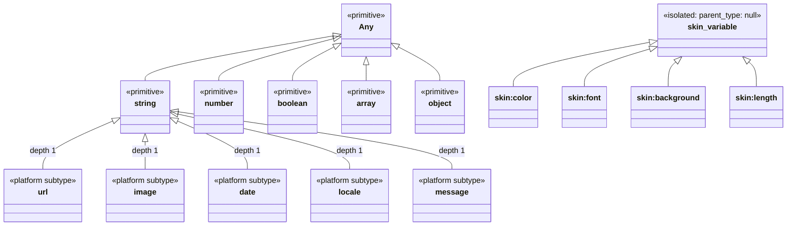
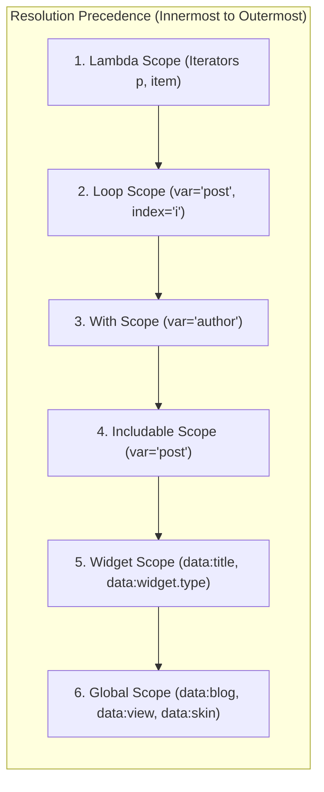

# Blogger Type System and Data Model

> Platform type ontology, radical isolation of Theme Designer variables (`skin:*`), type modifiers, deep traversal (`resolveDataPath`), and lexical scope stack (`ScopeEnvironment`).

---

## 1. Type System Ontology and Hierarchy

The `blogger-spec` type system formalizes the data structures injected into XML templates by the Blogger runtime. It is divided into standard primitives, enriched platform subtypes, and isolated Theme Designer types.



### 1.1. Platform Subtypes
The types `url`, `image`, `date`, `locale`, and `message` inherit **directly from `string` at depth 1**:
- Fully assignable to `string` (`isTypeAssignable('image', 'string') === true`).
- Support all native string operations (concatenation via `+`, comparisons, substring operations).
- Expose specialized computed modifiers (`.isResizable`, `.youtubeMaxResDefaultUrl`).

### 1.2. Four Canonical Boolean Literals
In Blogger XML templates, boolean attributes and expressions recognize exactly four literals:
- **Truthy:** `true`, `yes`.
- **Falsy:** `false`, `no`.
Any other value in strict boolean attributes is rejected by the parser.

---

## 2. Radical Isolation of Theme Designer (`skin:*`)

Variables declared inside `<b:skin>` via `<Variable>` tags (`skin:color`, `skin:font`, `skin:background`, `skin:length`, `skin:automatic`, `skin:string`, `skin:url`) have an impenetrable ontological boundary:

1. **`parent_type: null`:** They do not inherit from `string` or any primitive type.
2. **Assignability Incompatibility:**
   ```typescript
   import { isTypeAssignable } from 'blogger-spec/type-system'

   isTypeAssignable('image', 'string') // true (subtype of string)
   isTypeAssignable('skin:color', 'string') // false (strict isolation)
   ```
3. **Prohibition of String Modifiers:** A Theme Designer variable **cannot** receive standard string modifiers such as `.escaped`, `.length`, or `.jsonEscaped`. Attempting to do so triggers compiler diagnostics.

---

## 3. Type Modifiers

Modifiers are runtime computed properties accessed via dot notation:

### 3.1. Template Modifiers (Outside-Skin)
| Base Type | Modifier | Output Type | Description |
| :--- | :--- | :--- | :--- |
| `string` | `.escaped` | `string` | Escapes HTML entities for safe attribute interpolation. |
| `string` | `.length` / `.size` | `number` | Character length of the string. |
| `string` | `.jsonEscaped` | `string` | Escapes quotes and slashes for inline JSON within `<script>`. |
| `string` | `.jsEscaped` | `string` | Escapes line breaks and control characters for JavaScript strings. |
| `image` | `.isResizable` | `boolean` | `true` if the image is hosted on Google's CDN and accepts `resizeImage`. |
| `image` | `.isYoutube` | `boolean` | `true` if the URL is a YouTube video thumbnail. |
| `image` | `.youtubeMaxResDefaultUrl` | `url` | Max-resolution URL (`maxresdefault.jpg`) for YouTube thumbnails. |
| `array` | `.length` / `.size` | `number` | Number of items in the collection. |
| `array` | `.first` | `element` | First item of the collection (or `undefined` if empty). |
| `array` | `.last` | `element` | Last item of the collection. |
| `array` | `.empty` | `boolean` | `true` if length is 0. |

### 3.2. Skin Modifiers (Inside-Skin and `data:skin.vars.*` Expressions)
| Skin Type | Modifier | Output Type | Description |
| :--- | :--- | :--- | :--- |
| `skin:font` | `.family` | `string` | Font family stack or name (e.g. `Arial, sans-serif`). |
| `skin:font` | `.size` | `string` | Font size with CSS unit (e.g. `14px`, `1rem`). |
| `skin:font` | `.style` | `string` | CSS font style (`normal`, `italic`, `oblique`). |
| `skin:font` | `.weight` | `string` | CSS font weight (`normal`, `bold`, `700`). |
| `skin:color`| `.red` / `.green` / `.blue` | `number` | Integer RGB channels (0 to 255). |
| `skin:color`| `.alpha` | `number` | Alpha transparency channel (0.0 to 1.0). |

---

## 4. Deep Data Traversal with `resolveDataPath`

The `resolveDataPath(path, options)` function traverses deep member access paths across all catalogs and runtime models without requiring full template parser AST coupling:

```typescript
import { resolveDataPath } from 'blogger-spec/data-path'

// 1. Resolve typed global property
const urlProp = resolveDataPath('data:blog.url.canonical')
// { name: 'canonical', type: 'url', sourceCatalog: 'types' }

// 2. Resolve widget properties
const blogPosts = resolveDataPath('data:posts.first.title')
// { name: 'title', type: 'string', sourceCatalog: 'widgets' }

// 3. Resolve Theme Designer compound variables
const fontFam = resolveDataPath('data:skin.vars.body_font.family', {
  skinVariables: {
    'body.font': { name: 'body.font', type: 'font' },
  },
})
// { name: 'family', type: 'string', sourceCatalog: 'types' }
```

### Skin Variable Name Projection (`toSkinVarIdentifier`)
Blogger converts dots in Theme Designer variable names (`body.font`) to underscores (`body_font`) when projecting them into the `data:skin.vars.*` expression namespace. `resolveDataPath` transparently normalizes and resolves both representations.

---

## 5. Lexical Scope Stack (`ScopeEnvironment`)

Blogger uses a lexical scope stack to resolve identifiers within subroutines, loops, and control directives.



### 5.1. Resolution Rules
1. **Local-Wins (Lexical Shadowing):** If a local variable in `<b:with>` is named `title`, it shadows the widget's `title` property for the duration of the `<b:with>` block.
2. **Lambda Iterators Prohibited in `data:` (`BX1019`):**
   - Querying `x` inside a lambda `(x => ...)` resolves at Level 1 (`lambda`).
   - Querying `data:x` intentionally bypasses Level 1 and searches outer scopes, preventing collisions with the server namespace.

```typescript
import { ScopeEnvironment } from 'blogger-spec/scope'

const env = new ScopeEnvironment()
env.pushScope('widget', { widgetType: 'Blog' })
env.pushScope('loop', { symbols: { post: 'post' } })

env.resolveIdentifier('data:post') // Resolved: { scopeType: 'loop', ... }
env.pushScope('lambda', { symbols: { x: 'post' } })

env.resolveIdentifier('x') // Resolved: { scopeType: 'lambda', ... }
env.resolveIdentifier('data:x') // undefined (BX1019: lambda iterators prohibit data: prefix)
```
